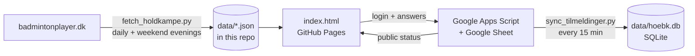

# HØBK — holdkampe, kalender og tilmelding

Web app and data pipeline for **Hørsholm Badminton Klub**. It shows every Hørsholm team's matches, results, lineups, standings, players and rankings — taken automatically from badmintonplayer.dk — plus a club calendar and a player login where members register for team matches and training.

**Live app:** https://christoffergroenfeldt-cyber.github.io/Hoebk/
(On iPhone: open in Safari → Share → *Add to Home Screen*.)

## What's in the app

| Tab | What it does |
|---|---|
| **Hold** | All 13 Hørsholm teams → match program, standings, players → every played match game by game |
| **Kalender** | Day / week / month / season view of all matches and weekly training, filter by team |
| **Min side** | Log in with a code sent by email; answer *Kan spille / Måske / Kan ikke* for matches and *Kommer / Kommer ikke* for training |
| **Rangliste** | Club ranking across all teams: games won, win %, total points, average per game; All / Senior / Youth |
| *Turneringer* (via Kalender) | All individual tournaments in Denmark grouped by level; matching ones on each player's profile and Min side; optional layer in the calendar |
| **Spillere** | Search every player → profile with stats, national rankings (single/double/mix), results by discipline, every game this season |

## How it fits together

Everything runs on free services: GitHub Actions and Pages (free for public repos) and a Google Sheet with Apps Script.

## Repository layout

| Path | Purpose |
|---|---|
| `index.html` | The whole app (HTML, CSS, JS in one file) |
| `manifest.webmanifest`, `icon*.png`, `icon.svg` | Home-screen install |
| `config.json` | App settings — `registrationUrl` switches login on |
| `fetch_holdkampe.py` | Fetches teams, matches, lineups, standings, player profiles |
| `sync_tilmeldinger.py` | Copies registrations from Google into SQLite + JSON |
| `apps-script/Code.gs` | Google Apps Script: email codes, sessions, registrations |
| `data/holdkampe.json` | Teams, matches, lineups, standings (generated) |
| `data/spillere.json` | Players, stats, rankings, club ranking (generated) |
| `data/turneringer.json` | Individual tournaments, whole country (generated) |
| `data/traening.json` | Weekly training times, season dates, holidays (**edited by hand**) |
| `data/tilmeldinger.json`, `data/hoebk.db` | Registrations (generated once login is set up) |
| `holdkampe-widget.html` | Optional snippet for the old Joomla site |
| `.github/workflows/` | `holdkampe.yml` (results) and `tilmeldinger.yml` (registrations) |

## Documentation

| Document | Read it when… |
|---|---|
| [docs/ARCHITECTURE.md](docs/ARCHITECTURE.md) | you want the big picture and the data flow |
| [docs/APP.md](docs/APP.md) | you change the app or its screens |
| [docs/DATA.md](docs/DATA.md) | you need the exact JSON / SQLite formats |
| [docs/BADMINTONPLAYER.md](docs/BADMINTONPLAYER.md) | badmintonplayer.dk changes and the fetcher breaks |
| [docs/TILMELDING.md](docs/TILMELDING.md) | you set up or change login and registration |
| [docs/OPERATIONS.md](docs/OPERATIONS.md) | running, scheduling, secrets, new season, troubleshooting |
| [docs/PRIVACY.md](docs/PRIVACY.md) | what personal data is stored where |

## Quick start (maintainer)

1. Results update by themselves — see [OPERATIONS.md](docs/OPERATIONS.md) for schedules and manual runs.
2. Training times: edit `data/traening.json` in GitHub's web editor; the app picks it up at once.
3. Login/registration: follow the 5 steps in [TILMELDING.md](docs/TILMELDING.md).
