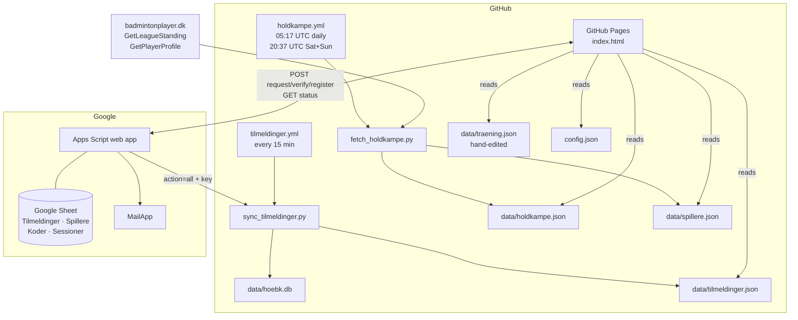

# Architecture

## Principles

- **No server of our own.** GitHub Pages serves static files; GitHub Actions does the scheduled work; a Google Apps Script receives the only thing a static site cannot handle — writes from users.
- **The repo is the database for public data.** Matches, results, players and registrations are committed as JSON (and SQLite) so the app reads plain files and the full history lives in Git.
- **Personal contact data never enters GitHub.** Emails and login codes stay in the Google Sheet.
- **Standard library only.** The Python scripts use no third-party packages, so workflows need no `pip install`.

## Components

## Data flows

### 1. Results (badmintonplayer.dk → app)

1. `holdkampe.yml` runs `fetch_holdkampe.py --club 1151 --profiles`.
2. The script gets a session token from the standings page, then calls Badminton Danmark's web service:
   club teams → each team's matches → each played match's lineup → each pulje's standings → each player's profile.
3. It writes `data/holdkampe.json` and `data/spillere.json` and the workflow commits them if anything changed.
4. GitHub Pages republishes automatically; the app fetches the JSON on every open (cache-busted per minute).

Details: [BADMINTONPLAYER.md](BADMINTONPLAYER.md), formats: [DATA.md](DATA.md).

### 2. Login and registration (app → Google → GitHub)

1. A player picks their name and enters an email in **Min side**. The app POSTs `request` to the Apps Script, which emails a 6-digit code.
2. The player enters the code; `verify` returns a random session token stored in the phone's `localStorage`.
3. Each answer is a `register` POST carrying the token — the server, not the app, decides which player is answering.
4. The app shows who's coming by GETting `?action=status` (latest answer per player and event, no emails).
5. Every 15 minutes `tilmeldinger.yml` pulls all answers with the secret key and rebuilds `data/hoebk.db` and `data/tilmeldinger.json`.

Details: [TILMELDING.md](TILMELDING.md).

### 3. Calendar

Built in the browser from `data/holdkampe.json` (matches) and `data/traening.json` (weekly sessions expanded over the season, minus holidays). Nothing is stored.

## Why these choices

| Decision | Reason |
|---|---|
| Static app on GitHub Pages | Free, no server to maintain, data already in the repo |
| Apps Script as receiver | A static page cannot hold a write key safely; Apps Script is free, sends email and gives trainers a spreadsheet |
| SQLite rebuilt from the full log each sync | Idempotent — a failed or repeated run can never double-count |
| JSON committed to Git | The app reads plain files; history and rollback come free |
| One-file app (`index.html`) | Easy to edit from a phone; no build step |

## Limits to know

- **Freshness:** results appear after the next scheduled run (morning, and Saturday/Sunday evening). Run the workflow manually for anything faster.
- **Registrations** show instantly in the app (read live from Google); the SQLite copy lags up to 15 minutes.
- **Email quota:** Apps Script on a normal Gmail account can send about 100 emails a day.
- **Players listed** are those who have played a team match this season; others type their name at login.
